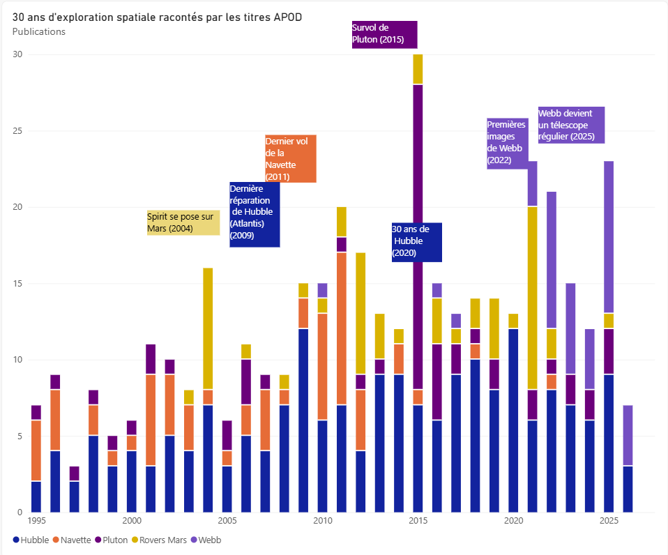
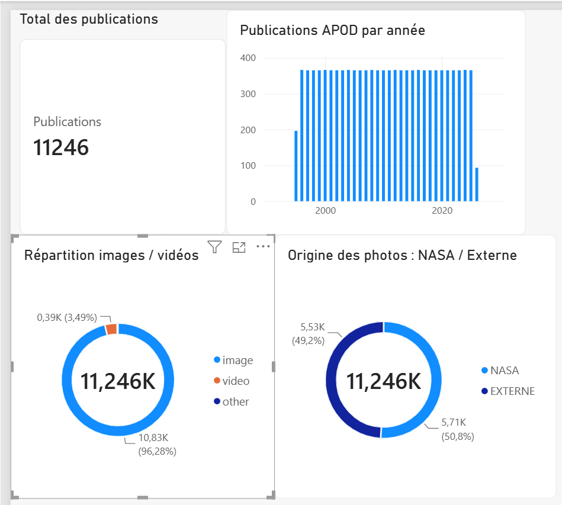

# 🚀 NASA Data Pipeline : 30 ans d'exploration spatiale racontés par l'APOD

> Pipeline ETL qui collecte les données ouvertes de la NASA, les stocke dans une base SQLite, puis les analyse en SQL et dans un dashboard Power BI.

Projet réalisé en binôme dans le cadre du Bachelor IA & Data (Ynov).

## 🌌 Problématique

**Comment les données ouvertes de la NASA permettent-elles de retracer l'évolution de l'exploration spatiale moderne ?**

On part de l'**APOD** (Astronomy Picture of the Day) : depuis le 16 juin 1995, la NASA publie chaque jour une image ou une vidéo d'astronomie, avec un titre et une explication.

Notre hypothèse : quand une mission fait l'actualité, son nom apparaît dans les titres. En comptant les noms de missions dans les titres, année par année, on doit donc pouvoir reconstruire une frise chronologique de l'exploration spatiale.

## 🎯 La réponse en bref

**Oui, les titres APOD suivent l'exploration spatiale presque à l'année près, et parfois au mois près.**

- **Hubble est le fil rouge** : c'est la seule mission présente toutes les années, de 1995 à 2026.
- **Les grands événements créent des pics** : le survol de Pluton (juillet 2015), l'arrivée de Spirit sur Mars (janvier 2004), la dernière réparation de Hubble (mai 2009).
- **On voit des époques se terminer** : la navette spatiale est très présente jusqu'en 2011, puis disparaît après son dernier vol.
- **On voit des époques commencer** : Webb apparaît en 2022 avec ses premières images, et devient en 2025 un télescope aussi présent que Hubble.

## 📊 Le dashboard



Chaque couleur correspond à une mission, et chaque barre compte les publications d'une année qui citent cette mission dans leur titre. Les annotations indiquent les événements réels qui expliquent les pics.

### Les événements retrouvés dans les données

| Année | Ce qu'on voit dans les données | Événement réel | Type de pic |
|-------|-------------------------------|----------------|-------------|
| 2004 | 8 titres Spirit, dont 5 en janvier | le rover Spirit se pose sur Mars le 4 janvier 2004 | événement |
| 2009 | 12 titres Hubble, dont 5 en mai | STS-125 : 5e et dernière mission de réparation de Hubble, par la navette Atlantis | événement |
| 2011 | Atlantis en juillet, avec des titres "Last" et "Farewell" | STS-135 : dernier vol de toute l'histoire des navettes américaines | fin d'une époque |
| 2015 | 20 titres Pluton, dont 8 en juillet | survol de Pluton par la sonde New Horizons le 14 juillet 2015 | événement |
| 2020 | 12 titres Hubble, dont 4 en avril | les 30 ans de Hubble (lancé en avril 1990) | anniversaire |
| 2022 | 10 titres Webb | premières images du télescope James Webb | nouveauté |
| 2025 | 11 titres Webb, répartis sur toute l'année | Webb devient un télescope régulier, son année record | tendance |

### Événement ou tendance ?

Tous les pics ne veulent pas dire la même chose. Pour faire la différence, on a zoomé mois par mois :

- **Pluton en 2015** : 8 titres concentrés sur 10 jours de juillet, autour du survol. C'est un **pic d'événement**.
- **Webb en 2025** : 11 titres étalés de janvier à novembre, sur des galaxies et nébuleuses différentes. Il n'y a pas d'événement unique : c'est un **pic de tendance**, Webb est devenu un outil du quotidien.

### Ce que ça répond à la problématique

Les données ouvertes de la NASA permettent de retracer l'exploration spatiale moderne parce qu'elles forment un **journal quotidien de 30 ans**, sans interruption. En les analysant, on retrouve à la fois :

- les **grands événements**, datés au mois près ;
- les **grandes transitions** : la fin de la navette (2011), le passage de Hubble à Webb ;
- la **façon dont la NASA communique** : elle met en avant ses missions, mais aussi ses anniversaires (les 30 ans de Hubble).

Limite principale : l'APOD montre ce que la NASA **choisit de publier**. C'est un bon miroir de l'exploration spatiale, mais pas un inventaire complet de toutes les missions.

## 🔍 Comment on a travaillé

### 1. Collecter les données (pipeline ETL)

```
API NASA  →  Python (extraction, nettoyage)  →  SQLite  →  SQL (analyse)  →  Power BI (dashboard)
```

- **Extract** (`scripts/fetch/fetch_apod.py`) : appel de l'API APOD année par année depuis 1995, sauvegarde du JSON brut
- **Transform** (`scripts/clean/clean_apod.py`) : sélection des colonnes utiles, `copyright` vide remplacé par `nasa`
- **Load** (`scripts/load/load_apod.py`) : insertion dans la base SQLite `data/nasa.db`

Résultat : **11 246 publications**, du 16/06/1995 au 04/04/2026.

### 2. Vérifier que la source est fiable

Avant d'analyser les titres, on a vérifié que l'APOD était une base solide :

- **une publication par jour, sans aucun jour manqué depuis 1996** (365 ou 366 par an) ;
- 96 % d'images et 3,5 % de vidéos ;
- environ la moitié des photos vient de photographes extérieurs à la NASA.



Une source aussi régulière permet de comparer les années entre elles : si une mission apparaît plus une année, ce n'est pas parce qu'il y a eu plus de publications.

### 3. Enquêter mission par mission en SQL

Pour chaque mission, on a suivi la même démarche, du plus large au plus précis :

1. **Compter par année** pour repérer les années qui ressortent
   ```sql
   select substr(date, 1, 4), count(*) from apod where title like '%Pluto%' group by substr(date, 1, 4);
   ```
2. **Zoomer par mois** sur l'année du pic
   ```sql
   select substr(date, 1, 7), count(*) from apod where title like '%Pluto%' and date like '2015%' group by substr(date, 1, 7);
   ```
3. **Lister les titres et les images** de ce mois pour comprendre de quoi ils parlent
   ```sql
   select date, title, url from apod where title like '%Pluto%' and substr(date, 1, 4) = '2015';
   ```
4. **Vérifier l'événement réel** (date de lancement, d'atterrissage, de survol…) dans des sources extérieures
5. **Noter la conclusion** en commentaire dans `analysis/queries.sql`

Toutes les requêtes, avec leur interprétation, sont dans [`analysis/queries.sql`](analysis/queries.sql).

### 4. Construire le dashboard Power BI

- Export de la table `apod` en CSV, puis chargement dans Power BI
- Dans Power Query, création d'une colonne conditionnelle `mission` : si le titre contient "Hubble", alors Hubble ; s'il contient "Webb" ou "JWST", alors Webb ; etc. C'est l'équivalent d'un `CASE WHEN` en SQL.
- Histogramme empilé : années en abscisse, nombre de publications en ordonnée, une couleur par mission
- Filtre pour retirer les publications qui ne citent aucune mission, et annotations sur les événements clés

### 5. Vérifier chaque chiffre deux fois

Les totaux de Power BI ont été comparés aux résultats SQL. Par exemple, la colonne `mission` donne 196 titres Hubble et 55 titres de rovers martiens, comme en SQL.

## 🧩 Problèmes rencontrés et solutions

| Problème | Comment on l'a repéré | Solution |
|----------|-----------------------|----------|
| Power BI additionnait les `id` au lieu de les compter (63 millions de publications au lieu de 11 246) | les chiffres ne correspondaient pas au SQL | passer `id` en "Nombre", puis en "Ne pas résumer" dans les propriétés de la colonne |
| Juillet 2011, mois du dernier vol de la navette, avait 0 titre "Shuttle" | trou inattendu en zoomant par mois | les titres disent "Atlantis" : ajout d'Atlantis dans la recherche |
| Le télescope Webb est aussi appelé "JWST" | même logique que pour Atlantis | recherche sur `Webb` **ou** `JWST` |
| "Endeavour Crater on Mars" ressortait avec les navettes | lecture des titres listés | un même mot peut avoir deux sens : un cratère sur Mars porte le nom de la navette |
| `copyright` contient `nasa` et `NASA` (5 lignes) | `!= 'NASA'` renvoyait presque toute la table | prise en compte des deux valeurs dans Power BI, correction prévue dans le nettoyage |
| 184 titres contiennent un retour à la ligne suivi de "Credit:" | aperçu des données dans Power Query | à corriger dans le script de nettoyage |

## ⚠️ Limites

- **Recherche par mot-clé** : une mission citée sous un autre nom, ou seulement dans l'explication, peut passer inaperçue. Un même mot peut aussi avoir deux sens (Endeavour est à la fois une navette et un cratère sur Mars).
- **Point de vue de la NASA** : l'APOD montre ce que la NASA choisit de publier, pas l'ensemble des missions spatiales (pas de missions chinoises, russes ou privées par exemple).
- **Pas de données d'audience** : on analyse ce qui est publié, pas ce qui est vu.
- **2026 est incomplète** : les données s'arrêtent au 4 avril 2026.

## 📝 Prochaines étapes

- Harmoniser `copyright` et nettoyer les titres dans le script de nettoyage
- Éviter les doublons dans `load_apod` : relancer le pipeline réinsère toutes les lignes
- Chercher les missions aussi dans le texte d'explication, pas seulement dans le titre
- Intégrer les autres sources NASA déjà collectées sur la branche `dev` (NeoWs, DONKI, Mars Rover) pour croiser les analyses

## 💼 Compétences mobilisées

- **Python** : appels API, traitement JSON, pipeline ETL
- **SQL** : `GROUP BY`, `COUNT`, `WHERE`, `LIKE`, `AND` / `OR`, `ORDER BY`, extraction de dates avec `substr`
- **Power BI** : Power Query, colonne conditionnelle, histogramme empilé, filtres, mise en forme
- **Démarche d'analyse** : question → hypothèse → exploration → zoom → vérification → conclusion
- **Qualité des données** : contrôle croisé SQL / Power BI, détection d'incohérences
- **Git / GitHub** : travail en binôme sur plusieurs branches, pull requests
- **Docker** : exécution du pipeline dans un conteneur

## 👥 Équipe

| Membre | Rôle |
|--------|------|
| [HOUDAED](https://github.com/HOUDAED) | Pipeline ETL : extraction API, nettoyage, chargement SQLite, Docker, pipelines NeoWs / DONKI / Mars Rover |
| [krm3z](https://github.com/krm3z) | Analyse : requêtes SQL, enquêtes par mission, dashboard Power BI, contrôle qualité, documentation |

## 🤖 Utilisation de l'IA

Un assistant IA a servi de support d'apprentissage : explication des erreurs SQL, aide sur les étapes de Power BI et sur la mise en forme de la documentation. Les requêtes, les enquêtes par mission, les recherches sur les événements réels et les interprétations ont été faites par l'équipe.

## ⚙️ Installation

```bash
git clone https://github.com/krm3z/nasa-data-pipeline.git
cd nasa-data-pipeline
python3 -m venv venv
source venv/bin/activate
pip install -r requirements.txt
cp .env.example .env
```

Mettre ensuite une clé API NASA dans `.env` (gratuite sur https://api.nasa.gov).

## 🔄 Lancer le projet

**Pipeline complet**
```bash
python main.py
```

**Étape par étape**
```bash
python -m scripts.fetch.fetch_apod
python -m scripts.clean.clean_apod
python -m scripts.load.load_apod
```

**Avec Docker**
```bash
docker build -t nasa-pipeline .
docker run --env-file .env nasa-pipeline
```

**Analyse SQL**
```bash
sqlite3 data/nasa.db < analysis/queries.sql
```

**Dashboard** : ouvrir `powerbi/apod_dashboard.pbix` avec Power BI Desktop.

## 📁 Structure du projet

```
nasa-data-pipeline/
├── analysis/
│   └── queries.sql       ← requêtes d'analyse commentées
├── config/
│   └── config.py         ← paramètres centralisés
├── data/                 ← non versionné
│   ├── raw/              ← données brutes API
│   ├── processed/        ← données nettoyées
│   └── nasa.db           ← base SQLite
├── docs/
│   ├── missions.png      ← graphique des missions
│   └── dashboard.png     ← premières vérifications
├── powerbi/
│   └── apod_dashboard.pbix
├── scripts/
│   ├── fetch/            ← extraction API
│   ├── clean/            ← nettoyage
│   └── load/             ← chargement SQLite
├── Dockerfile
├── main.py               ← lance tout le pipeline
├── .env.example          ← modèle pour la clé API
└── requirements.txt
```
